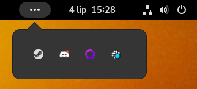
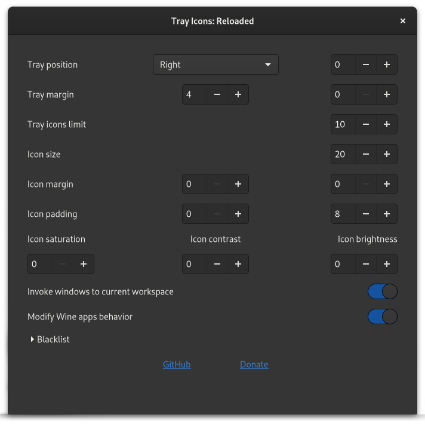

# Tray Icons: Reloaded

Tray Icons: Reloaded is a [GNOME Shell](https://www.gnome.org/) extension that restores legacy XEmbed tray icons to the top panel and adds per-application behavior controls.

This repository is a compatibility-maintained fork of the original project.

## Compatibility

- Fedora 45 with GNOME Shell 51.1.
- GNOME Shell 50 is also declared in `metadata.json`.
- An X11 display is required. GNOME on Xorg is the supported session; pure Wayland is not supported by the legacy tray backend. XWayland applications may work when they expose an XEmbed tray icon.
- This extension handles legacy XEmbed tray icons, not AppIndicator or StatusNotifierItem indicators. Do not run another extension that owns the same tray icons at the same time.
- [snixembed](https://git.sr.ht/~steef/snixembed) can expose some applications as legacy tray icons and can provide native menus.

## Wayland

If an application does not use XWayland automatically, start it with:

```bash
GDK_BACKEND=x11 app_name
```

## Features

### Panel and overflow



- Place the tray on the left, center, or right side of the panel.
- Set the panel position weight and left/right tray margins.
- Move icons into an overflow menu when the configured icon limit is reached. The default limit is 4.
- Configure icon size, margins, padding, saturation, contrast, and brightness.

### Application behavior



- Left-click can open, minimize, or activate the application associated with a tray icon.
- Middle-click follows the tray application's normal behavior. Shift + middle-click requests application termination.
- Move activated windows to the current workspace by default.
- Apply special left- and middle-click handling to Wine applications.
- Hide selected applications while keeping their tray processes running.
- Configure the applications list from the Applications preferences page.

## Preferences

The preferences window contains these pages and controls:

- **General**: tray position, position weight, icon limit, and icon size.
- **Colors**: icon saturation, contrast, and brightness.
- **Spacing**: tray margins, icon margins, and icon padding.
- **Behavior**: current-workspace activation and Wine behavior.
- **Applications**: add applications and mark them hidden.

## Dependencies

At runtime the extension uses the GNOME Shell and GJS APIs provided by the desktop. No JavaScript package manager or external runtime is required.

The Qt and snixembed compatibility paths call `pmap` and `pidof`; Fedora's `procps-ng` package provides these commands. The main tray display does not depend on them.

To build a release archive, install `make` and `zip`.

## Installation

Build the extension archive from a checkout:

```bash
make zip
```

Install the archive into the UUID-specific user extension directory:

```bash
extension_dir="$HOME/.local/share/gnome-shell/extensions/trayIconsReloaded@selfmade.pl"
rm -rf "$extension_dir"
mkdir -p "$extension_dir"
unzip -q trayIconsReloaded@selfmade.pl.zip -d "$extension_dir"
```

Enable and open preferences with the GNOME extension tools:

```bash
gnome-extensions enable trayIconsReloaded@selfmade.pl
gnome-extensions prefs trayIconsReloaded@selfmade.pl
```

After updating an existing checkout, rebuild the archive and repeat the installation step so the installed directory contains the latest files.

## Troubleshooting

- Check the session type with `echo "$XDG_SESSION_TYPE"`; `x11` is required for the legacy tray manager.
- Confirm the application actually provides an XEmbed tray icon. AppIndicator and StatusNotifierItem-only applications need a separate bridge such as snixembed.
- Check GNOME Shell errors with `journalctl --user -b` after enabling the extension.

## Credits

Evolved from [unite-shell](https://github.com/hardpixel/unite-shell), [TopIcons Plus](https://github.com/phocean/TopIcons-plus), TopIcons, and [TopTray](https://github.com/mjnaderi/TopTray).
